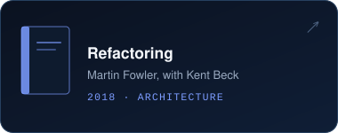
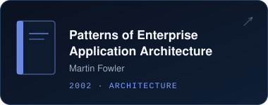
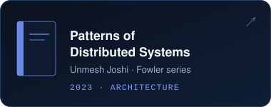
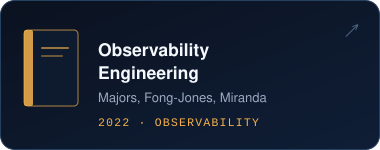
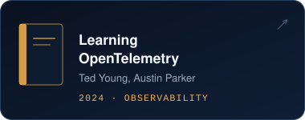
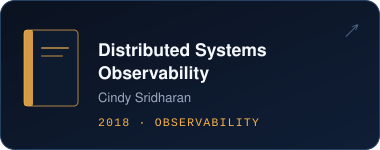

  <picture><source media="(prefers-color-scheme: light)" srcset="./assets/light/header.svg" /></picture>

  
  
  
  

 

  <picture><source media="(prefers-color-scheme: light)" srcset="./assets/light/impact.svg" /></picture>

 

## `> about`

I'm a **Principal Software Engineer at Dell Technologies** with 14 years of building backend and cloud platforms. I set the technical direction for the distributed job orchestration engine behind **Dell OpenManage Enterprise**: Go microservices on **k3s**, coordinated through **Kafka** and backed by **Valkey** and **PostgreSQL**, running 10,000 concurrent jobs in production.

I care about the unglamorous parts that make platforms trustworthy: clean service boundaries, failure handling, secrets management, and systems that are easy to operate at 3 a.m.

  <picture><source media="(prefers-color-scheme: light)" srcset="./assets/light/focus.svg" /></picture>

 

## `> featured work`

  <a href="https://dl.dell.com/content/manual4185069-visualizing-openmanage-enterprise-alerts-and-telemetry-in-grafana-through-kafka.pdf?language=en-us"><picture><source media="(prefers-color-scheme: light)" srcset="./assets/light/featured/whitepaper.svg" /></picture></a>
  <a href="https://github.com/mohiadeen-ameer/OpenManage-Enterprise/tree/main/Kafka"><picture><source media="(prefers-color-scheme: light)" srcset="./assets/light/featured/kafka-project.svg" /></picture></a>

 

## `> career`

  <picture><source media="(prefers-color-scheme: light)" srcset="./assets/light/timeline-v3.svg" /></picture>

 

## `> stack`

  <picture><source media="(prefers-color-scheme: light)" srcset="./assets/light/stack.svg" /></picture>

 

## `> reading`

Engineering blogs I follow closely:

  <a href="https://github.blog/"><picture><source media="(prefers-color-scheme: light)" srcset="./assets/light/blogs/github.svg" /></picture></a>
  <a href="https://www.uber.com/blog/engineering/"><picture><source media="(prefers-color-scheme: light)" srcset="./assets/light/blogs/uber.svg" /></picture></a>
  <a href="https://netflixtechblog.com/"><picture><source media="(prefers-color-scheme: light)" srcset="./assets/light/blogs/netflix.svg" /></picture></a>

  <a href="https://stripe.com/blog"><picture><source media="(prefers-color-scheme: light)" srcset="./assets/light/blogs/stripe.svg" /></picture></a>
  <a href="https://dropbox.tech/"><picture><source media="(prefers-color-scheme: light)" srcset="./assets/light/blogs/dropbox.svg" /></picture></a>
  <a href="https://www.linkedin.com/blog/engineering"><picture><source media="(prefers-color-scheme: light)" srcset="./assets/light/blogs/linkedin.svg" /></picture></a>

  <a href="https://strimzi.io/blog/"><picture><source media="(prefers-color-scheme: light)" srcset="./assets/light/blogs/strimzi.svg" /></picture></a>
  <a href="https://opensearch.org/blog/"><picture><source media="(prefers-color-scheme: light)" srcset="./assets/light/blogs/opensearch.svg" /></picture></a>
  <a href="https://spring.io/blog"><picture><source media="(prefers-color-scheme: light)" srcset="./assets/light/blogs/spring.svg" /></picture></a>

 

## `> bookshelf`

Books on architecture and observability I keep coming back to:

  <a href="https://martinfowler.com/books/refactoring.html"><picture><source media="(prefers-color-scheme: light)" srcset="./assets/light/books/refactoring.svg" /></picture></a>
  <a href="https://martinfowler.com/books/eaa.html"><picture><source media="(prefers-color-scheme: light)" srcset="./assets/light/books/poeaa.svg" /></picture></a>
  <a href="https://martinfowler.com/books/patterns-distributed.html"><picture><source media="(prefers-color-scheme: light)" srcset="./assets/light/books/pods.svg" /></picture></a>

  <a href="https://www.oreilly.com/library/view/observability-engineering/9781492076438/"><picture><source media="(prefers-color-scheme: light)" srcset="./assets/light/books/observability-engineering.svg" /></picture></a>
  <a href="https://www.oreilly.com/library/view/learning-opentelemetry/9781098147174/"><picture><source media="(prefers-color-scheme: light)" srcset="./assets/light/books/learning-otel.svg" /></picture></a>
  <a href="https://www.oreilly.com/library/view/distributed-systems-observability/9781492033431/"><picture><source media="(prefers-color-scheme: light)" srcset="./assets/light/books/dso.svg" /></picture></a>

 

## `> writing`

  <a href="https://medium.com/@mohiadeen-ameer/intelligent-automation-advancing-operational-resilience-through-event-driven-validation-b02b65c130bb"><picture><source media="(prefers-color-scheme: light)" srcset="./assets/light/writing/supportplus.svg" /></picture></a>
  <a href="https://medium.com/@mohiadeen-ameer/how-i-improved-backend-communication-with-grpc-and-protobuf-in-a-large-scale-healthcare-system-d534a62a2c47"><picture><source media="(prefers-color-scheme: light)" srcset="./assets/light/writing/grpc.svg" /></picture></a>
  <a href="https://medium.com/@mohiadeen-ameer/guide-to-migrate-java-applications-from-was-to-liberty-129cfff9d31d"><picture><source media="(prefers-color-scheme: light)" srcset="./assets/light/writing/liberty.svg" /></picture></a>

<a href="https://medium.com/@mohiadeen-ameer">More articles on Medium →</a>

