

  

  
  
  
  

 

  

 

## `> about`

I'm a **Principal Software Engineer at Dell Technologies** with 14 years of building backend and cloud platforms. I set the technical direction for the distributed job orchestration engine behind **Dell OpenManage Enterprise**: Go microservices on **k3s**, coordinated through **Kafka** and backed by **Valkey** and **PostgreSQL**, running 10,000 concurrent jobs in production.

I care about the unglamorous parts that make platforms trustworthy: clean service boundaries, failure handling, secrets management, and systems that are easy to operate at 3 a.m.

  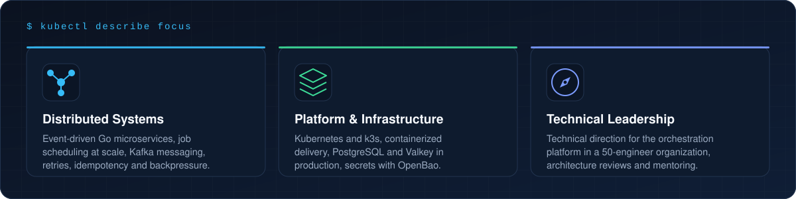

 

## `> featured work`

  <a href="https://dl.dell.com/content/manual4185069-visualizing-openmanage-enterprise-alerts-and-telemetry-in-grafana-through-kafka.pdf?language=en-us">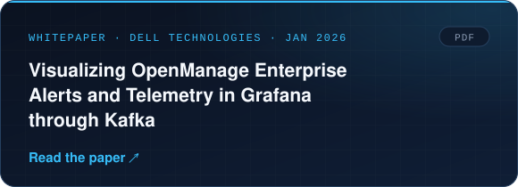</a>
  <a href="https://github.com/mohiadeen-ameer/OpenManage-Enterprise/tree/main/Kafka">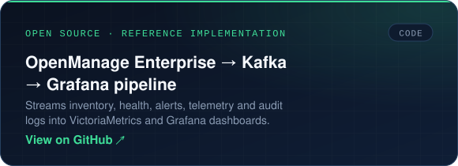</a>

 

## `> career`

  

 

## `> stack`

  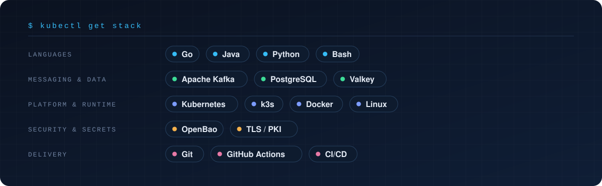

 

## `> reading`

Engineering blogs I follow closely:

  
  
  

  
  
  <a href="https://www.linkedin.com/blog/engineering">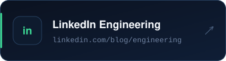</a>

  
  
  

 

## `> writing`

  <a href="https://medium.com/@mohiadeen-ameer/intelligent-automation-advancing-operational-resilience-through-event-driven-validation-b02b65c130bb">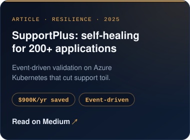</a>
  <a href="https://medium.com/@mohiadeen-ameer/how-i-improved-backend-communication-with-grpc-and-protobuf-in-a-large-scale-healthcare-system-d534a62a2c47">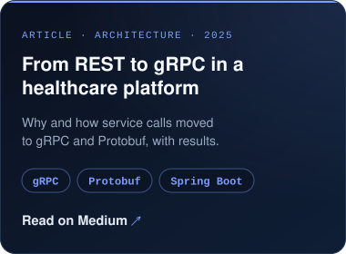</a>
  <a href="https://medium.com/@mohiadeen-ameer/guide-to-migrate-java-applications-from-was-to-liberty-129cfff9d31d">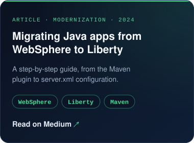</a>

<a href="https://medium.com/@mohiadeen-ameer">More articles on Medium →</a>

