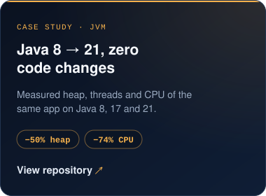
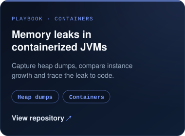
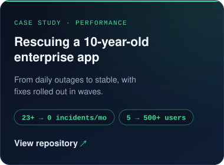

  

  

  
  
  
  

 

  

 

## `> about`

I'm a **Principal Software Engineer at Dell Technologies** with 14 years of building backend and cloud platforms. I set the technical direction for the distributed job orchestration engine behind **Dell OpenManage Enterprise**: Go microservices on **k3s**, coordinated through **Kafka** and backed by **Valkey** and **PostgreSQL**, running 10,000 concurrent jobs in production.

I care about the unglamorous parts that make platforms trustworthy: clean service boundaries, failure handling, secrets management, and systems that are easy to operate at 3 a.m.

  

 

## `> featured work`

  
  

 

## `> career`

  

 

## `> stack`

  

 

## `> reading`

Engineering blogs I follow closely:

  
  
  

  
  
  

 

## `> projects`

  
  
  

